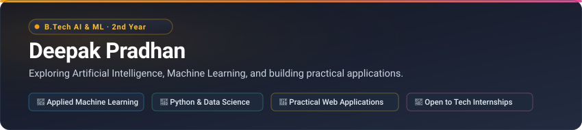

  

 

## 👋 About Me

I am a **2nd-year B.Tech student in Artificial Intelligence & Machine Learning** at **NIMS University Rajasthan, Jaipur**.

My learning approach is centered around building practical software and understanding machine learning from the fundamentals. Rather than focusing only on theory, I spend my time building data pipelines, evaluating models with transparent metrics, and creating functional web tools.

- 🎓 **Education:** 2nd-year B.Tech in AI & ML, NIMS University Rajasthan (2024–2028)
- 💡 **Interests:** Machine Learning, Python development, applied NLP, and practical web applications
- 🛠️ **Approach:** Learning by actively building and documenting real projects
- 💼 **Opportunity:** Actively open to AI/ML and software engineering internship opportunities

---

## 🛠️ Technical Skills

- **Programming Languages:** Python (Intermediate), C (Foundational), SQL (Foundational), JavaScript, HTML5, CSS3
- **Machine Learning & Data Science:** Scikit-learn, Pandas, NumPy, Matplotlib, Seaborn, Sentence Transformers
- **Web & Application Development:** Streamlit, FastAPI
- **Developer Tools & Environment:** Git, GitHub, VS Code, Jupyter Notebook
- **API Integration:** Google Gemini API, Groq API

> *Self-Assessment:* Intermediate in Python; foundational in C and SQL; practical experience with data analysis, scikit-learn regression/classification pipelines, and interactive web tools.

---

## 🌟 Featured Projects

### 1. [AI Resume Screener](https://github.com/deepakpradhan1021/resume-screener)
An intelligent semantic text matcher that extracts content from PDF resumes, calculates mathematical cosine similarity against job descriptions, identifies matched skills and missing qualifications, and generates targeted improvement tips via an LLM.
- **Tech Stack:** Python, Streamlit, Sentence Transformers (`all-MiniLM-L6-v2`), Scikit-learn, Groq API (`openai/gpt-oss-20b`), pdfplumber
- **Key Implementation:** Dense embedding similarity, regex-based skill boundary extraction, automated unit tests (`unittest`), and downloadable summary reports.
- **Links:** 🔗 [Repository](https://github.com/deepakpradhan1021/resume-screener) • 🚀 [Live Demo](https://resume-screener-fl9mggq8t6kvww6xn6pvbf.streamlit.app/)

### 2. [Pixel Path](https://github.com/deepakpradhan1021/Pixel_Path)
A retro-inspired 20-level 2D browser platformer engineered completely from scratch using vanilla web standards with zero external game engines or physics libraries.
- **Tech Stack:** HTML5 Canvas, Vanilla JavaScript (ES6+), CSS3, Web Audio API
- **Key Implementation:** Custom 2D physics engine (coyote time, jump buffering, AABB bounding box collision resolution), 5 distinct biomes, procedural 8-bit sound synthesis via native `AudioContext`, and mobile touchscreen support.
- **Links:** 🔗 [Repository](https://github.com/deepakpradhan1021/Pixel_Path) • 🕹️ [Play Online](https://deepakpradhan1021.github.io/Pixel_Path/)

### 3. [Dual-Market House Price Prediction](https://github.com/deepakpradhan1021/house-price-prediction)
A comparative real estate valuation web application that evaluates housing price drivers across two distinct global markets: Bengaluru (India) and Ames, Iowa (USA).
- **Tech Stack:** Python, Streamlit, Scikit-learn, Pandas, Joblib
- **Key Implementation:** Ames Random Forest Regressor ($R^2 \approx 0.89$), Bengaluru Gradient Boosting Regressor ($R^2 \approx 0.79$), dynamic currency formatting (₹ Lakh/Crore vs. $ USD), and locality frequency clustering.
- **Links:** 🔗 [Repository](https://github.com/deepakpradhan1021/house-price-prediction) • 🚀 [Live Demo](https://house-price-prediction-isncgvvwk89mvcahtd33rr.streamlit.app/)

### 4. [Titanic Survival Predictor](https://github.com/deepakpradhan1021/titanic-survival-prediction)
An end-to-end binary classification pipeline and interactive passenger survival simulator based on historical maritime demographics.
- **Tech Stack:** Python, Scikit-learn, Streamlit, Pandas, Seaborn
- **Key Implementation:** Full data leakage prevention via `ColumnTransformer` (median & mode imputation + one-hot encoding), Random Forest model (~82% test accuracy), and real-time preset passenger comparisons.
- **Links:** 🔗 [Repository](https://github.com/deepakpradhan1021/titanic-survival-prediction) • 🚀 [Live Demo](https://titanic-survival-prediction-c3s4sq29gwey7kgtujcntq.streamlit.app/)

### 5. [docRag](https://github.com/deepakpradhan1021/docRag)
A lightweight Document Question & Answering (RAG) platform designed to operate efficiently within strict free-tier cloud limits (<85 MB RAM).
- **Tech Stack:** Python, FastAPI, Streamlit, PyMuPDF, LangChain, Google Gemini API, Scikit-learn
- **Key Implementation:** In-memory Okapi BM25 keyword indexing + sublinear character n-grams, verified 1-indexed page citations with source excerpts, sliding-window rate limiting, and reproducible synthetic evaluation benchmark.
- **Links:** 🔗 [Repository](https://github.com/deepakpradhan1021/docRag) • 🚀 [Live Demo (Render)](https://docrag-3gb4.onrender.com)

### 6. [NumPy Practice & Analysis](https://github.com/deepakpradhan1021/numpy-practice)
Hands-on Jupyter notebooks exploring array computing and statistical analysis on simulated educational datasets.
- **Tech Stack:** Python, NumPy, Jupyter Notebook
- **Key Implementation:** Array creation, slicing, boolean masking, vector operations, broadcasting rules, and statistical distributions (mean, median, standard deviation) across 200 student records.
- **Links:** 🔗 [Repository](https://github.com/deepakpradhan1021/numpy-practice)

---

## 📈 Learning Journey & Practice

In addition to full applications, I maintain structured coding practice:

- 🐍 **[AI_ML-](https://github.com/deepakpradhan1021/AI_ML-):** Daily Python roadmap covering syntax, control flow logic, decision algorithms, and procedural console applications (ATM simulator, calculator, electricity billing).
- 🌐 **[Web Development Foundations](https://github.com/deepakpradhan1021/1):** Core laboratory exercises comparing inline, internal, and external CSS styling methodologies and client-side DOM scripting.

---

## 📜 Certifications & Completed Courses

- 🏅 [Kaggle: Intermediate Machine Learning](https://www.kaggle.com/learn/certification/deepakpradhan1612/intermediate-machine-learning) — *Verified Certificate*
- 🏅 [Kaggle: Intro to Machine Learning](https://www.kaggle.com/learn/certification/deepakpradhan1612/intro-to-machine-learning) — *Verified Certificate*
- 📘 **Kaggle:** Pandas & Data Analysis — *Coursework Completed*

---

## 📬 Connect With Me

I am always interested in discussing technical projects, receiving constructive code feedback, and exploring internship opportunities.

- 💼 **LinkedIn:** [linkedin.com/in/deepak-pradhan-728b6737a](https://www.linkedin.com/in/deepak-pradhan-728b6737a)
- 🐙 **GitHub:** [@deepakpradhan1021](https://github.com/deepakpradhan1021)
